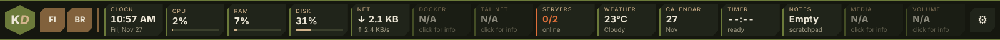
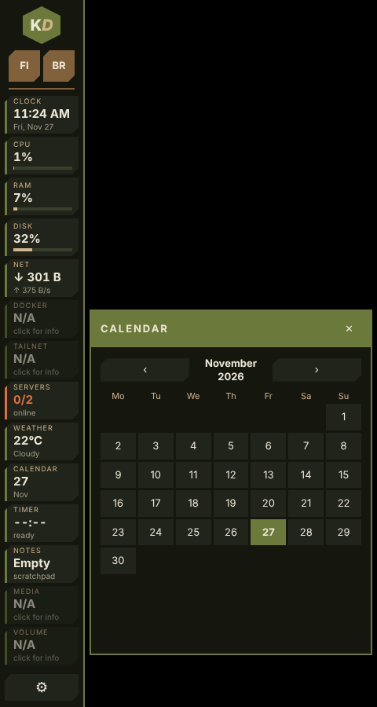

# Kinetic Dock

A tactical widget dock for **Linux and Windows**. Pinned apps, system stats, homelab status and daily tools on one bar along any edge of your screen.

No account, no telemetry, no runtime dependencies beyond Electron.



On the left or right edge the dock turns vertical:



## Widgets

| Group | Widgets |
|---|---|
| System | CPU, RAM, disk, network speed |
| Homelab | Docker containers, Tailscale peers, server checks (HTTP or TCP) |
| Daily | Clock, weather, calendar, timer, notes |
| Media | Now playing, volume |

## Run it

Needs [Node.js](https://nodejs.org) 22.12 or newer.

```bash
npm install
npm start
```

## Build installers

```bash
npm run dist:linux   # AppImage in dist/
npm run dist:win     # Windows installer in dist/ (run on Windows)
```

GitHub Actions also builds both on each push to `main`. Download them from the run's **Artifacts**.

## Linux extras

| Tool | Used for |
|---|---|
| `xprop` | Reserving screen space so windows don't cover the dock |
| `playerctl` | Media widget |
| `wpctl` or `pactl` | Volume widget |
| `docker`, `tailscale` | Their widgets |

```bash
# Mint / Ubuntu
sudo apt install x11-utils playerctl
# CachyOS / Arch
sudo pacman -S xorg-xprop playerctl
```

On Bazzite, `xprop` and `playerctl` may already be present; check with `command -v xprop playerctl`.

## Controls

- **Click a widget** to open its panel. `Esc` closes it.
- **⚙** edits the screen edge (bottom, top, left or right), city, pinned apps, servers and widget order.
- **Ctrl+Alt+K** shows or hides the dock.
- **Right-click** the dock, or use the tray icon, to quit.

Pinned apps use `Name | command`, servers use `Name | URL` or `Name | host:port`:

```text
Steam | steam
Immich | http://192.168.0.10:2283
Minecraft | 192.168.0.10:25565
```

Pinned commands run in your shell, so only add commands you trust.

## Known limits

- **Wayland:** the app runs through XWayland. Positioning and space reservation depend on the compositor, so the dock may float or misplace on some desktops (notably GNOME and KDE Wayland). X11 sessions such as Mint Cinnamon are the best fit.
- **Windows:** the dock sits above the taskbar and floats over maximised windows. It does not replace the taskbar or reserve space.
- **Windows volume:** buttons work, but the level isn't shown.
- **Server checks:** TCP and HTTP only, so UDP services (DayZ, Minecraft Bedrock) can't be checked.
- **Open app windows** aren't listed on the dock.
- **Weather** comes from [Open-Meteo](https://open-meteo.com), whose free API is for non-commercial use.

## Add a widget

1. Add an entry to `src/renderer/widgets.js`.
2. Add its id to `WIDGETS` in `src/main/config.js`.
3. If it needs system data, add a loader to `SOURCES` in `src/main/main.js`.

## Troubleshooting

If `npm start` on Ubuntu or Mint reports a `chrome-sandbox` error:

```bash
sudo chown root:root node_modules/electron/dist/chrome-sandbox
sudo chmod 4755 node_modules/electron/dist/chrome-sandbox
```
